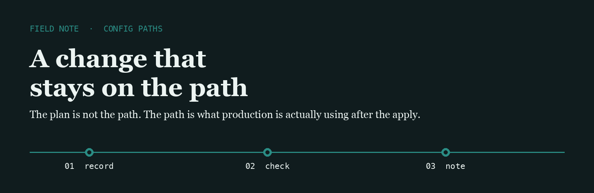
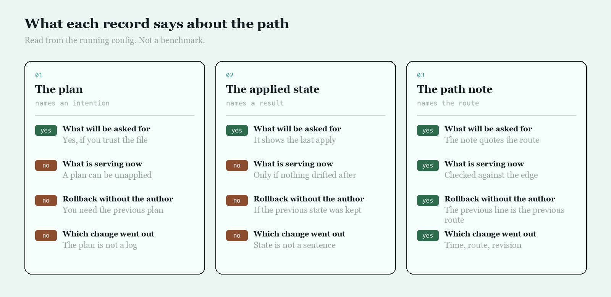

<p align="center">
  
</p>

# Cloud Path

Cloud Path is the name I use for the unglamorous distance between a config edit and the route that is really serving traffic.

## The question

People trust the plan, the applied state, or a ticket. I asked which of those tells you the path a request will take now.

<p align="center">
  
</p>

|  | The plan | The applied state | The path note |
| --- | --- | --- | --- |
| What will be asked for | Yes, if you trust the file | It shows the last apply | The note quotes the route |
| What is serving now | A plan can be unapplied | Only if nothing drifted after | Checked against the edge |
| Rollback without the author | You need the previous plan | If the previous state was kept | The previous line is the previous route |
| Which change went out | The plan is not a log | State is not a sentence | Time, route, revision |

## The line I keep

One line, written after the apply and checked at the edge. The rollback is the previous line.

```text
2026-03-08T02:40:11Z  edge  /api  rev 19ac44d  serving the applied path
```

Planning tools already know how to describe a change. The gap is a line that says which path is serving, written by someone who looked.

- [terraform](https://github.com/hashicorp/terraform) describes a change before it is applied
- [opentofu](https://github.com/opentofu/opentofu) is the open plan I read when I want the same idea without the vendor lock
- [pulumi](https://github.com/pulumi/pulumi) describes that change in a general-purpose language

I keep a fork of each on this account.

## What I pay attention to

- A path that can be named after the apply, not only before it
- A rollback that is the previous route, not a meeting
- A drift that shows up as a different path, not as a red icon
- Tools small enough to read in one sitting

## Working with me

Send a short problem statement, a way to see it happen, and what done looks like. I am independent, remote, and usually around during the Singapore workday.
